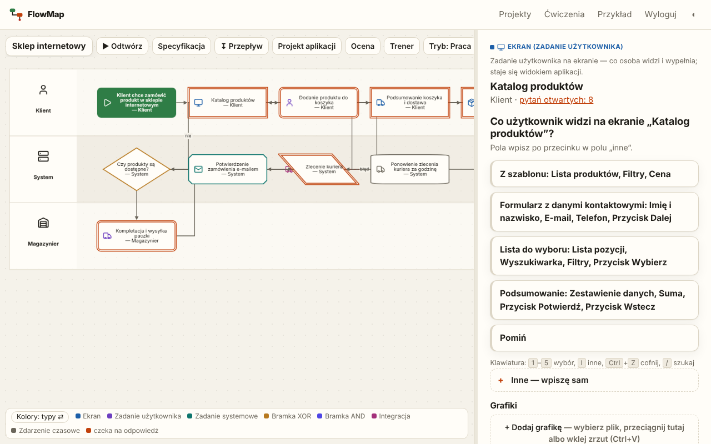
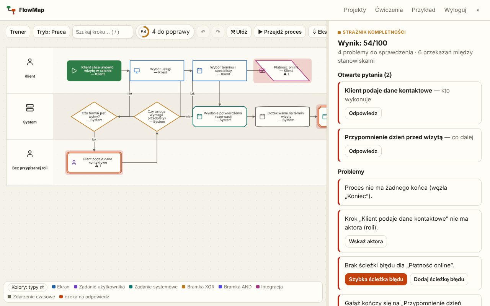
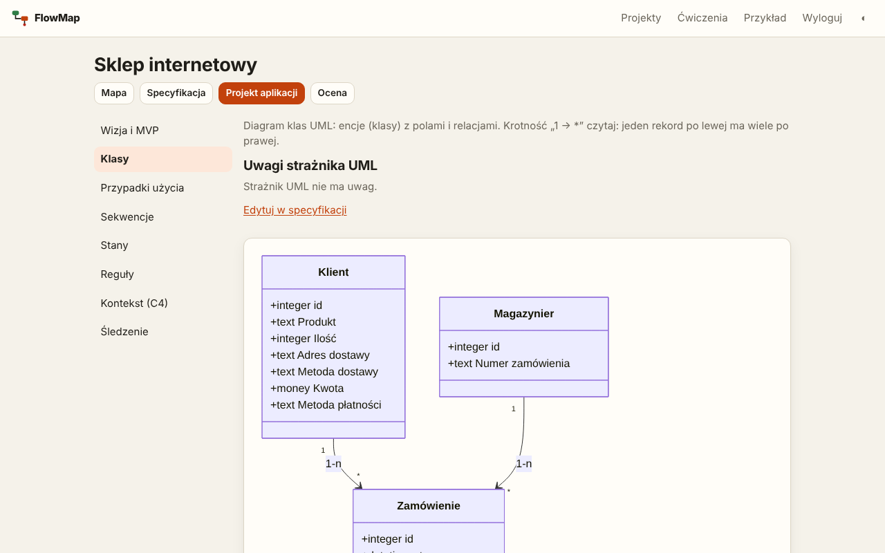
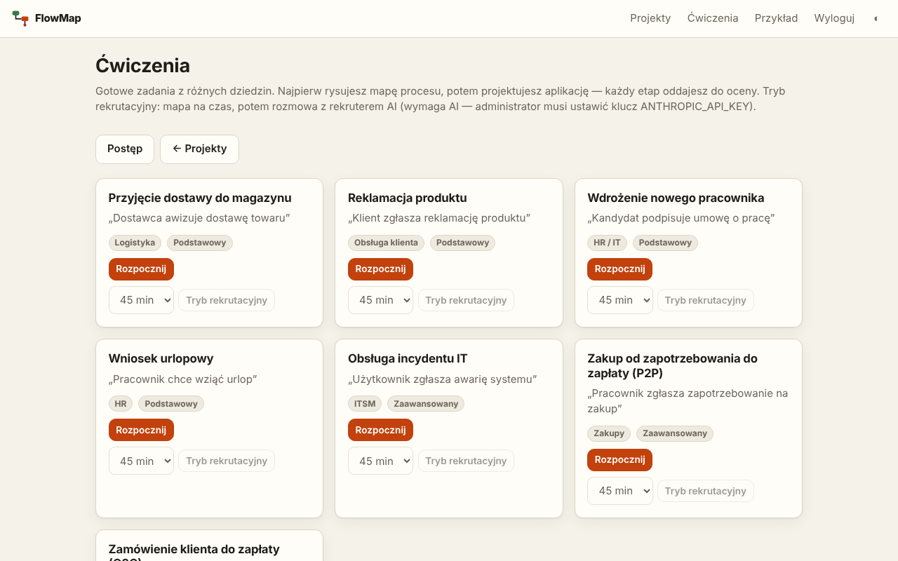

# FlowMap

[](https://github.com/TomaszWu14/flowmap/actions/workflows/ci.yml)
[](https://github.com/TomaszWu14/flowmap/actions/workflows/security.yml)
[](LICENSE)

**Demo: https://flowmap.twapp.pl**



> **English summary.** FlowMap is a Flask web app for designing new applications through an
> **interactive process map**. You type one sentence ("A customer wants to book a salon visit"),
> the app keeps asking "what happens next?" with 3–5 suggested answers, and the map (Cytoscape.js)
> grows live. A completeness guard scores the map 0–100 and highlights gaps (branches without an end,
> missing error paths, steps without an actor). From the finished map FlowMap derives a technical
> specification (entities, screens, roles, statuses, integrations), UML views (class, use case,
> sequence, state, C4 context — Mermaid), BPMN 2.0 XML and a ready-to-paste ZIP package for
> AI code generators. It also has a learning mode: fixed exercises (O2C, P2P, IT incidents…),
> rule-based scoring with an optional AI review, a progress page and a timed recruitment mode.
> Works without an API key (rules + templates); with one it uses Claude via the `anthropic` SDK.
> Stack: Python 3.12, Flask, SQLAlchemy/Alembic, HTMX, PostgreSQL, pytest (380+ tests), ruff,
> security scans in CI (gitleaks, Bandit, Semgrep, pip-audit, Trivy). The UI is in Polish.
> Live demo: https://flowmap.twapp.pl · Screenshots: see [Zrzuty ekranu](#zrzuty-ekranu) (process map
> with guided questions, completeness guard, UML class diagram, exercise catalogue).

Aplikacja webowa do projektowania nowych aplikacji przez **interaktywną mapę procesu**.

Wpisujesz jedno zdanie, np. „Klient chce umówić wizytę w salonie”. FlowMap pyta krok po kroku
„co dzieje się dalej?”, podsuwa 3–5 gotowych odpowiedzi (kafelki) i opcję „inne”, a mapa procesu
rysuje się na żywo aż do końca. Z gotowej mapy powstaje specyfikacja, diagram (Mermaid, BPMN 2.0)
i gotowe polecenie dla generatora kodu (Claude Code, Lovable, Bolt).

## Co potrafi

- **Prowadzenie pytaniami** — tryb szybki (ok. 5 pytań, kroki „paczkami”) i dokładny (ok. 20 pytań:
  aktor, pola ekranu, dane, ścieżki błędów). Decyzje tworzą gałęzie, każda gałąź to otwarte pytanie.
- **Edycja mapy** — kliknij krok: zmień, usuń, dodaj krok po nim, połącz z istniejącym (pętla),
  oznacz jako koniec. Cofnij / ponów i pełna historia wersji z przywracaniem.
- **Strażnik kompletności** — wynik 0–100 na mapie, problemy podświetlone na węzłach: gałąź bez końca,
  decyzja z < 2 wyjściami, krok bez aktora, brak ścieżki błędu przy płatności/integracji, krok
  nieosiągalny, brak końca. Opcjonalny przegląd AI z dodawaniem kroków jednym kliknięciem.
- **Przejdź proces** — symulacja z perspektywy wybranej roli, jak klikalna makieta, z podsumowaniem
  (kroki, ekrany, ślepe zaułki).
- **Eksport** — specyfikacja Markdown (proces, role, ekrany, model danych, powiadomienia, historyjki
  z kryteriami akceptacji, scenariusze testów, otwarte pytania), Mermaid, BPMN 2.0 XML, prompt dla
  generatora kodu, eksport/import projektu w JSON.
- **Specyfikacja techniczna** — zakładka „Specyfikacja” wyprowadzana z mapy: encje z polami i relacjami,
  ekrany, role z uprawnieniami, statusy, powiadomienia, integracje, wymagania niefunkcjonalne. Ręczne
  zmiany przetrwają zmiany mapy, wskaźnik „Gotowość dla Claude Code” pokazuje braki. Opcjonalny przegląd
  techniczny AI tworzy propozycje do zatwierdzenia (AI niczego nie zmienia samo).
- **Projekt aplikacji** — zakładka z widokami UML wyprowadzonymi ze specyfikacji (diagram klas, przypadków
  użycia, sekwencji, stanów, kontekstu C4 — podgląd Mermaid, plik `UML.md`), strażnik UML z wyjaśnieniem
  „dlaczego” przy każdym problemie i opcjonalny szkic wizji/zakresu MVP od AI.
- **Paczka dla Claude Code** — ZIP ze specyfikacją, modelem danych i poleceniem do wklejenia
  (`/p/<id>/eksport/claude-code.zip`).
- **Tryb bez AI** — bez klucza API aplikacja działa na regułach i 3 szablonach procesów
  (rezerwacja wizyty, zamówienie w sklepie, zgłoszenie serwisowe).
- **Mapa z dokumentu** — wklejasz opis procesu, powstaje szkic mapy (AI albo reguły), pytania uzupełniają gałęzie.
- **Wspólna praca** — współpracownicy z rolą edytor lub podgląd; **link do podglądu** bez logowania (mapa,
  specyfikacja, symulacja); **komentarze** przy krokach (otwarte liczy strażnik).
- **Historia** — porównanie dwóch wersji mapy (dodane, usunięte i zmienione kroki z podświetleniem).
- **Własne szablony** — gotową mapę zapisujesz jako szablon; tryb bez AI podpowiada z niej kroki.
- **Eksport zadań** — Jira (CSV), Linear (CSV), GitHub Issues (JSONL + polecenie `gh`).
- **Ocena i trener** — zakładka „Ocena”: wynik 0–100 za mapę i projekt aplikacji z listą kryteriów (reguły,
  opcjonalnie z jakościową oceną AI) i historią; czat „Trener” znający mapę, strażników i ostatnią ocenę.
- **Ćwiczenia** — katalog 7 zadań (m.in. O2C, P2P, wniosek urlopowy, incydent IT, reklamacja, przyjęcie
  dostawy, onboarding) uruchamianych jako projekt w trybie nauki; strona **Postęp** (`/postep`) z trendem,
  mocnymi stronami i tym, co ćwiczyć dalej; **tryb rekrutacyjny** — ćwiczenie na czas, po czasie mapa
  się blokuje i zaczyna się rozmowa z AI zakończona raportem.
- **Grafiki** — zrzuty ekranu, zdjęcia stanowisk i skany przy krokach oraz materiały projektu (okładka, galeria).
- **Konto** — „Nie pamiętam hasła” (link e-mailem przez SMTP albo jednorazowy link od admina).
- Publiczna strona z przykładowym projektem: `/przyklad`.
- **Panel administratora** `/admin`: statystyki; ustawienia bez redeployu (rejestracja, wyłącznik AI, limit AI); koszty AI (`/admin/koszty`: tokeny i koszt per funkcja);
  lista kont z blokowaniem, nadawaniem uprawnień i linkiem do ustawienia hasła; dziennik zdarzeń
  (`/admin/zdarzenia`). Treści cudzych projektów nie widać. Uprawnienia nadaje tylko `flask set-admin`
  (albo `flask create-user --admin`).

## Zrzuty ekranu

**Strażnik kompletności** — wynik 0–100, problemy podświetlone na mapie i szybkie poprawki:



**Projekt aplikacji** — widoki UML wyprowadzone ze specyfikacji (tu diagram klas):



**Ćwiczenia** — katalog zadań w trybie nauki i tryb rekrutacyjny:



## Stos

Python 3.12, Flask (app factory, blueprinty), Flask-SQLAlchemy + Flask-Migrate (Alembic), Flask-Login,
Flask-WTF (CSRF), Jinja2 + HTMX, Cytoscape.js + dagre (w `app/static/vendor`, bez kroku budowania),
SQLite w dev / PostgreSQL w produkcji, SDK `anthropic` (tool use + Pydantic), pytest, ruff, gunicorn.

## Uruchomienie lokalnie

```bash
python -m venv .venv
source .venv/bin/activate            # Windows: .venv\Scripts\activate
pip install -r requirements-dev.txt
cp .env.example .env                 # opcjonalnie: ANTHROPIC_API_KEY

export FLASK_APP=app:create_app      # Windows PowerShell: $env:FLASK_APP="app:create_app"
flask db upgrade                     # tworzy instance/flowmap.db (SQLite)
flask create-user ty@example.com     # zapyta o hasło (min. 12 znaków)
flask set-password ty@example.com    # zmiana hasła istniejącego konta
flask set-admin ty@example.com       # uprawnienia administratora (--revoke odbiera)
flask run                            # http://127.0.0.1:5000
```

Testy i lint:

```bash
pytest
ruff check .
```

Docker (app + PostgreSQL):

```bash
cp .env.example .env   # uzupełnij SERVICE_HEX_32_POSTGRES i SERVICE_PASSWORD_64_SECRETKEY (openssl rand -hex 32)
docker compose up --build
docker compose exec app flask create-user ty@example.com
```

## Zmienne środowiskowe

| Zmienna | Domyślnie | Opis |
|---|---|---|
| `APP_ENV` | `development` | `production` włącza bezpieczne ciasteczka, ProxyFix i wymaga `SECRET_KEY` |
| `SECRET_KEY` | (dev) | klucz sesji — w produkcji obowiązkowy |
| `DATABASE_URL` | `sqlite:///flowmap.db` | `postgresql://…` w produkcji (hasło w hex!) |
| `ALLOW_SIGNUP` | `true` | `false` wyłącza rejestrację (konta tylko przez `flask create-user`) |
| `COOKIE_SECURE` | `true` w produkcji | flaga `Secure` ciasteczek |
| `ANTHROPIC_API_KEY` | — | bez klucza działa tryb reguł i szablonów |
| `ANTHROPIC_MODEL` | `claude-sonnet-5-5` | model do pytań, ocen i rozmowy rekrutacyjnej |
| `AI_TIMEOUT_SECONDS` | `60` | timeout jednego zapytania |
| `AI_DAILY_LIMIT` | `100` | limit zapytań AI na użytkownika na dzień (nadpisywany w panelu admina) |
| `MAIL_SERVER`, `MAIL_PORT`, `MAIL_USERNAME`, `MAIL_PASSWORD`, `MAIL_FROM`, `MAIL_USE_TLS` | — | SMTP; włącza „Nie pamiętam hasła” |
| `RESET_TOKEN_HOURS` | `1` | ważność linku resetu wysyłanego e-mailem |
| `NTFY_URL` | — | pełny URL tematu ntfy (np. `https://ntfy.sh/<tajny-temat>`); powiadomienie push o każdym nowym gościu bramki |
| `NTFY_TOKEN` | — | opcjonalny token (`Authorization: Bearer`) dla serwera ntfy z kontrolą dostępu |
| `NTFY_WATCH_COMPANIES` | — | frazy firm po przecinku (bez wielkości liter i polskich znaków); gość z taką firmą = push `urgent` „UWAGA firma z listy”. Ustawiaj tylko w środowisku |
| `NTFY_ENGAGED_VIEWS` | `10` | jeden push „Gość ogląda demo”, gdy gość obejrzy tyle ekranów; `0` = wyłączone |

W `docker-compose.yml` hasło bazy i `SECRET_KEY` pochodzą ze zmiennych `SERVICE_HEX_32_POSTGRES`
i `SERVICE_PASSWORD_64_SECRETKEY` — Coolify generuje je sam. Hasło bazy jest w hex, bo znaki `/ + @`
psują `DATABASE_URL`.

## Bezpieczeństwo

CSRF na formularzach i żądaniach HTMX (nagłówek `X-CSRFToken`), każdy endpoint projektu sprawdza
właściciela (cudzy projekt → 404), treść użytkownika i AI escapowana w szablonach i eksportach,
etykiety Cytoscape jako tekst, nagłówki CSP/X-Frame-Options/nosniff/Permissions-Policy/COOP (HSTS za HTTPS).
Do AI trafia tylko mapa (klucze, typy, tytuły, aktorzy, etykiety) — bez danych konta. Prompty w `app/prompts/*.md`.

W CI (`.github/workflows/security.yml`) każdy PR przechodzi skany: gitleaks (sekrety), Bandit i Semgrep
`p/owasp-top-ten` (SAST), pip-audit (zależności) i Trivy (HIGH/CRITICAL z poprawką); Dependabot co tydzień
proponuje aktualizacje. Zgłaszanie podatności i szczegóły: [SECURITY.md](SECURITY.md).

## Struktura

```
app/
  __init__.py  config.py  models.py  extensions.py  settings.py  audit.py  mail.py  text.py
  auth/       logowanie, rejestracja, reset hasła
  admin/      panel administratora, koszty AI, dziennik zdarzeń
  projects/   lista, tworzenie, kopia, wersje
  flow/       mapa, pytania (questions.py), strażnik (guard.py), symulacja, historia i porównanie wersji
  spec/       specyfikacja techniczna: wyprowadzanie z mapy, edycja, gotowość, przegląd AI, paczka ZIP
  design/     projekt aplikacji: widoki UML (Mermaid), strażnik UML, wizja/MVP
  trainer/    ocena (reguły + AI) i czat trenera
  exercises/  ćwiczenia (data/*.json), postęp, tryb rekrutacyjny
  share/  comments/  media/   link do podglądu i współpracownicy, komentarze, grafiki
  export/     Markdown, Mermaid, BPMN, prompt, JSON, zadania (Jira/Linear/GitHub), przykład publiczny
  ai/         client.py (SDK), schemas.py (Pydantic), rules.py (pytania bez AI), templates.py, pricing.py
  prompts/    prompty AI (*.md)
  static/  templates/
migrations/  tests/  Dockerfile  docker-compose.yml  docs/WDROZENIE.md
```

Wdrożenie na Coolify: [docs/WDROZENIE.md](docs/WDROZENIE.md).
